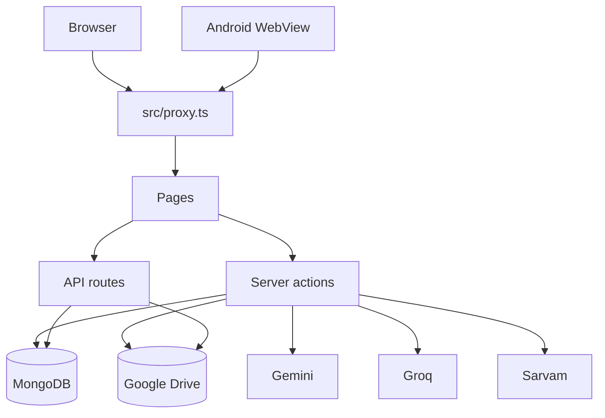

# Technical architecture

Snapshot: 24 October 2026. Package `allyouneed` at `0.1.0`.

## Stack

| Piece | Choice |
| --- | --- |
| App | Next.js 16.2.2, App Router, React 19.2.4, TypeScript strict (`@/*` → `src/*`) |
| Style | Tailwind CSS v4 |
| Data | MongoDB via Mongoose 9.3.3. Connection cached in `src/lib/mongodb.ts` |
| Auth | NextAuth 4.24 (`src/lib/auth.ts`) |
| Files | The user's Google Drive (`src/lib/storage.ts`). Not S3 |
| Email | Nodemailer (`src/lib/mailer.ts`). If SMTP is unset, the message is logged |
| AI | Gemini (chat, MOM audio, receipt extract), Groq (fallback chat, Whisper), Sarvam (optional paid speech-to-text) |
| Phone | Capacitor 8. WebView loads the hosted site. App id `com.allyouneed.app` |
| Host | Vercel, region `bom1` (`vercel.json`). Canonical origin `https://allyouneedvault.vercel.app` |

Next 16 renamed middleware to proxy. The session gate is `src/proxy.ts`. Read `node_modules/next/dist/docs/` before using a Next API this codebase has not already used. `AGENTS.md` calls that out.

Server Actions are the API. `'use server'` modules live in `src/actions/`. REST is only auth, native handoff, Drive OAuth, and the file proxy.

`src/lib/models/registry.ts` recompiles a Mongoose model in dev when its schema object changes.

`next.config.ts` externalizes `pdf-parse` / `pdfjs-dist`, sets server-action body limit to 30mb (meeting audio), and sets download headers for `public/app-debug.apk`.

## Layout

```
src/actions/     server actions — the trust boundary
src/app/         pages and the few API routes
src/components/  UI, auth screens, Capacitor listeners
src/lib/         models, auth, access rules, Drive, AI, mail
src/proxy.ts     session gate
android/         Capacitor Android project
tests/unit/      Vitest
scripts/         dev wrapper, dead-link cron, self-check, Atlas migrate
```

## Request path



## Data model

All schemas are in `src/lib/models/`.

| Model | Role |
| --- | --- |
| User | Account, verification, PIN, Drive token, Sarvam key, Jarvis day-count, suspension, deletion |
| Project | `ownerId` creator, plus `ownerEmails`, `memberEmails`, `viewerEmails` |
| Link, Category | Saved URLs and domain rules. Private flag is personal |
| Task | Assignees, due date, reminder, sign-off, optional `projectId` and `momId` |
| Note | Body and attachments. Optional project and meeting |
| Document | Digi Locker file or link |
| Mom | Audio, transcript, summary, candidates, which engine ran |
| Message, ChatRead | Group chat and read cursor |
| Event | Activity trail for a group |
| Expense | Personal money row. Optional receipt document |
| Contact | Address book |
| Suggestion | Feedback, including screenshot metadata |
| JarvisSession | Assistant transcript per user |
| NativeAuthCode | One-time code for Android Google sign-in. TTL index |

Personal rows are owned by `userId` and have no `projectId`. Shared rows carry `projectId`. A row with a `projectId` cannot be private (`src/lib/privacy.ts`).

## Server actions

| Module | Does |
| --- | --- |
| `auth.ts` | Register, reset password, email code |
| `account.ts`, `accounts.ts` | Delete account; park and switch accounts |
| `pin.ts` | Private Safe PIN |
| `link.ts`, `category.ts` | Links and categories |
| `note.ts`, `document.ts` | Notes and Digi Locker |
| `task.ts`, `project.ts` | Tasks, groups, members, workspace bundle |
| `message.ts` | Group chat |
| `mom.ts` | Upload, transcribe, extract, confirm, delete |
| `jarvis.ts` | Ask, confirmed writes, voice, sessions |
| `expense.ts` | Ledger and receipt extract |
| `contact.ts` | Contacts and the optional invite |
| `drive.ts` | Drive status and disconnect |
| `search.ts`, `notifications.ts` | Search and the in-app feed |
| `admin.ts`, `suggestion.ts` | Admin user actions and feedback |
| `sarvamKey.ts` | User's own Sarvam key |
| `intro.ts`, `visibility.ts` | Onboarding flags and the first-share notice |

## HTTP routes

| Path | Role |
| --- | --- |
| `/api/auth/[...nextauth]` | NextAuth |
| `/api/auth/native/handoff`, `/api/auth/native/done` | Android Custom Tab finishes Google sign-in and deep-links back |
| `/api/drive/connect`, `/api/drive/callback` | Drive OAuth. Public at the proxy because the Custom Tab has no session cookie. Each route checks a session or a signed handoff |
| `/api/files/[...key]` | Streams a file from the owner's Drive after an auth and ownership check |

## Files

`src/lib/storage.ts` is the only upload path. Bytes go to the uploader's Drive. Folder tree: `ALL-YOU-NEED / personal | digilocker | <group name>`. A group folder wins over the tab the upload started from.

- Upload cap in app code: 4MB (`MAX_UPLOAD_BYTES`), because the serverless body limit is about 4.5MB. Meeting audio is a server action and uses the 30MB action limit instead.
- No Drive connected: upload is refused. There is no S3 and no `public/uploads` fallback.
- Teammates read through `/api/files`, so a password account still works. A Drive reader grant is best-effort and is not required.
- Removing someone from a group ends app access immediately. Their Drive copy is not revoked. That is disclosed on purpose.
- Feedback screenshots go to an admin Drive (`FEEDBACK_DRIVE_EMAIL`) so a report works with no Drive of their own.
- `@aws-sdk/client-s3` is still in `package.json` and is unused by `src/`. Do not document or wire a new S3 path.

The server stores a Drive refresh token, so "files live in your Drive" is not "we cannot read them".

## AI call path

- **Gemini** — Jarvis and MOM extraction (`src/lib/llm.ts`), MOM audio up to the size Gemini accepts (`src/lib/geminiAudio.ts`), expense receipts (`src/lib/expenseExtract.ts`). Model from `GEMINI_MODEL`, default `gemini-3.6-flash`.
- **Groq** — chat fallback, Whisper for MOM when Gemini audio is not the path, Jarvis voice transcription.
- **Sarvam** — batch speech-to-text for Hindi and Hinglish when the user has a key or an admin grant (`src/lib/sarvam.ts`).
- **Jarvis cap** — `JARVIS_DAILY_LIMIT = 5` in `src/lib/jarvisLimit.ts`, counted in the asker's timezone (`Asia/Kolkata` if unknown).
- Wall-clock times from the model are anchored in the asker's zone in `src/lib/time.ts`. Display is 12-hour.

## Auth implementation

Providers in `src/lib/auth.ts`: Google (only if the client id and secret exist), email/password (bcrypt), and `native-handoff` (not shown in the UI; completes Android Google sign-in).

Private Safe: PIN hashed on the user. After a correct PIN, an HMAC cookie (`safeAuth`, 12 hours) is set with `NEXTAUTH_SECRET`. Five failures lock the PIN for 15 minutes (`src/lib/pinLock.ts`). The PIN is not encryption.

Sarvam keys are sealed before storage (`src/lib/secretBox.ts`) and are not returned to the browser.

## Environment names

No `.env.example`. Set these on the host. Do not commit values.

| Name | Used for |
| --- | --- |
| `MONGODB_URI` | Database |
| `NEXTAUTH_SECRET` | Sessions, HMAC cookies, sealed secrets |
| `NEXTAUTH_URL` | NextAuth base URL. Must be one origin. Locally that is `http://localhost:3000` |
| `NEXT_PUBLIC_APP_URL` | Links that leave the machine: email, share, QR. Read only via `appUrl()` in `src/lib/url.ts` |
| `NEXT_PUBLIC_SHARE_URL` | Optional override of the share base |
| `GOOGLE_CLIENT_ID`, `GOOGLE_CLIENT_SECRET` | Google sign-in and Drive |
| `GEMINI_API_KEY`, `GEMINI_MODEL` | Gemini |
| `GROQ_API_KEY` | Groq |
| `SARVAM_API_KEY` | Founder Sarvam billing for admin grants |
| `SARVAM_ENABLED_EMAILS` | Deprecated allowlist. Prefer the admin toggle |
| `ADMIN_EMAILS` | Who may open `/admin`. Overrides the code default. Empty string means nobody |
| `SMTP_HOST`, `SMTP_PORT`, `SMTP_USER`, `SMTP_PASS`, `SMTP_FROM` | Mail |
| `DRIVE_FOLDER_NAME` | Root folder name in Drive |
| `FEEDBACK_DRIVE_EMAIL` | Which admin Drive stores screenshots |
| `CAP_SERVER_URL` | Optional https tunnel for a dev WebView |
| `NEXT_DIST_DIR` | Alternate Next output directory |

`S3_BUCKET` and the `AWS_*` names in `README.md` are unused.

Google Cloud redirect URIs that must exist: `/api/auth/callback/google` and `/api/drive/callback`, for localhost and for production. Until the OAuth client is verified, Google expires refresh tokens on a short cycle. That is an ops blocker, not an app-code blocker.

## Android

`capacitor.config.ts` points the WebView at the production origin. `CAP_SERVER_URL` (https only) overrides it for a tunnel. Deep link scheme: `com.allyouneed.app://`.

Plugins: `@capacitor/app`, `browser`, `local-notifications`, `preferences`, `share`, `@mindlib-capacitor/send-intent`. In-app `SmsInbox` (Java, `com.allyouneed.app.SmsInboxPlugin`) reads classic SMS for `/sms-inbox`; TS bridge in `src/lib/native/smsInbox.ts`.

Ship a new APK only when native code changes. Then bump `versionCode` and `versionName` in `android/app/build.gradle`, mirror both and the user-facing notes in `src/lib/appRelease.ts`, and replace `public/app-debug.apk`. `tests/unit/appRelease.test.ts` fails if Gradle and `LATEST` disagree. `.github/workflows/android.yml` checks the committed APK.

## Scripts and checks

| Script | Role |
| --- | --- |
| `npm run dev` | `scripts/dev-safe.js` |
| `npm run verify` | `tsc`, Vitest, lint budget |
| `npm run selfcheck` | `scripts/self-check.mjs` — invariants that must stay true without a database |
| `npm test` | `tests/unit` |
| `node scripts/check-dead-links.js` | Weekly dead-link mark |

There is no end-to-end browser suite in the repo.

## Deploy

Vercel: set `NEXTAUTH_URL` and `NEXT_PUBLIC_APP_URL` to the same public https origin in production. They must stay separate in development, or invite emails contain `localhost`.

A VPS needs TLS (cookies and the microphone). Meeting upload needs a proxy body limit of at least 30MB. Cron: `0 3 * * 0` running `scripts/check-dead-links.js`.
